## 1. Задача і метрика

Я детектую 8 класів (person, bicycle, car, van, truck, tricycle, bus, motor) на кожному кадрі відео з дрона окремо, часова структура потрібна тільки для поділу даних

- Метрика - COCO mAP@[.5:.95], ignored regions рахуються як iscrowd, maxDets = 500. Додатково дивлюсь на AP50, AP75, AP_S/M/L і швидкість. LB - публічний лідерборд
- Усі val-цифри - офіційна оцінка vd.coco_eval на оригінальних кадрах 7 val-кліпів

## 2. Дані і передобробка (01_eda_split)

|  | train | val | test |
|---|---|---|---|
| кліпів / кадрів | 56 / 24 201 | 7 / 2 846 | 48 / 3 811 |
| об'єктів на кадр | 45.7 (макс. 180) | 40.1 (макс. 116) | - |

**Спостереження**

- Класи сильно незбалансовані: у train car 45.7 %, person 29.7 %, bus 0.9 %. Val за складом інший - person 44 %, а bus лише 264 (01_fig1)
- Медіанний розмір sqrt(w*h) - 45.8 px (5-95 перцентиль: 20-130 px). Small 25 %, medium 64 %, large 12 %. Person, bicycle і motor на 25-40 % small, bus на 57 % large (01_fig2). Після resize до короткої сторони 720 медіана десь 30 px
- Кліпи дуже різні: від 5 до 143 об'єктів на кадр, різний домінантний клас, train до 2688x1512, test від 680x382 до 1920x1080 (01_fig3, 01_fig4)
- Ignored regions є на 75 % train-кадрів і займають близько 26 % площі
- IoU того самого об'єкта між кадрами t і t+k: 0.90 (k=1), 0.66 (k=4), 0.44 (k=8)

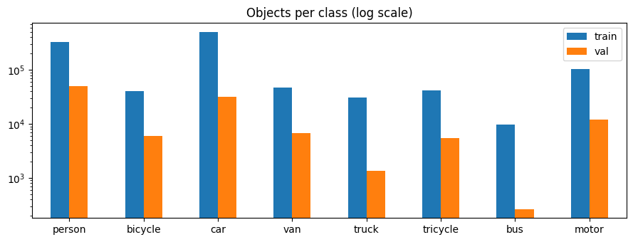

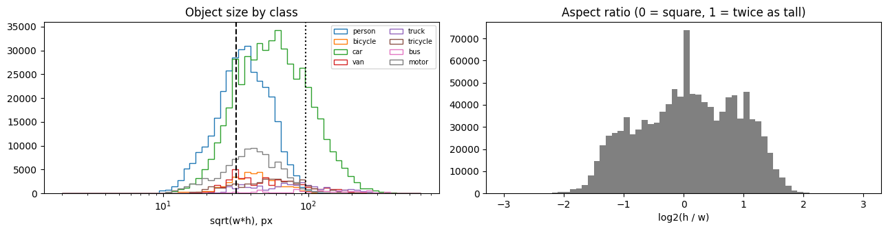

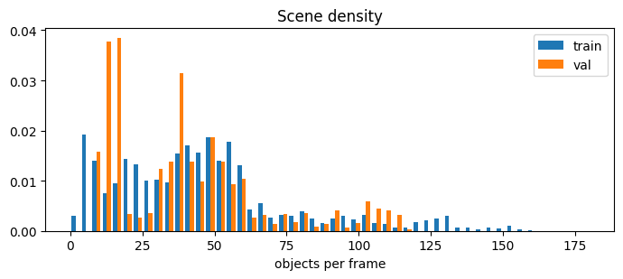

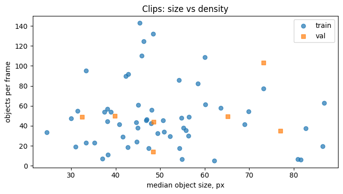

| спостереження | рішення |
|---|---|
| сусідні кадри майже однакові, кліпи - незалежні сцени | split по кліпах (val організаторів, 0 спільних кліпів). Train: кожен 4-й кадр (6 072) для YOLO/RT-DETR, кожен 8-й (3 036) для torchvision-моделей, бо вони приблизно в 3 рази повільніші. При k=8 IoU 0.44, тобто кадри ще різні |
| медіана близько 30 px на вході | вхід 1280 (пробував 1536), P2 head, тайли на інференсі |
| найменший стандартний anchor (32) більший за медіану | якорі RetinaNet 16-256 |
| дисбаланс, val інший за складом | AP по класах, обережні висновки з val |
| до 180 об'єктів на кадр | max_det 500, порівняння 300 і 500 запитів |

**Конвертація.** COCO -> YOLO (нормовані центр і розміри). У розмітці є тільки 8 цільових класів і ignored regions, окремого класу "others" немає. У train-кадрах ignored regions заливаю сірим (114) і викидаю GT з центром усередині, це 3 274 рамки. В оцінці вони лишаються як iscrowd, тому детекції там не штрафуються. Конвертацію перевірив очима: GT і ignored regions на кадрах (01_fig5) і записані YOLO-мітки на замаскованих кадрах (01_fig6)

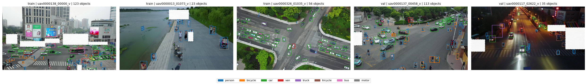

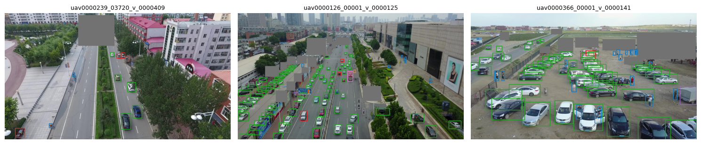

**Resize, нормалізація, аугментації**

- YOLO/RT-DETR: letterbox 1280, ділення на 255. Torchvision: коротка сторона 720, довга до 1280 (для 16:9 той самий масштаб), mean/std ImageNet
- Torchvision-моделі вчу тільки з h-flip, щоб протокол у пари був однаковий і мінімальний. Для Ultralytics лишив стандартні augmentations (mosaic, HSV, scale, translate, flip, erasing, mosaic вимикається на останніх епохах)
- Seed 42 всюди

## 3. Валідація і протокол

Усередині кожної пари порівнянь однакові кадри, масштаб входу, оцінка і seed

|  | FRCNN / RetinaNet | YOLO11 | RT-DETR |
|---|---|---|---|
| train-кадри | 3 036 | 6 072 | 6 072 |
| бюджет | 4 епохи | 6 епох (базова 12) | 1 год (YOLO11s вистачило близько 45 хв) |
| оптимізатор | SGD 0.01, cosine, warm-up 300 ітерацій | AdamW 8.3e-4, cosine, warm-up 3 епохи | як у YOLO |

Швидкість torchvision - чистий GPU-час, а в Ultralytics вона разом із читанням з диска, тому напряму їх порівнювати не зовсім коректно

## 4. Двостадійний: Faster R-CNN (03_two_stage_faster_rcnn)

Взяв fasterrcnn_resnet50_fpn_v2 з COCO-вагами і новою головою на 9 класів (8 + фон). mAP по епохах на підмножині val (кожен 10-й кадр, не офіційна цифра): 0.199 -> 0.219 -> 0.226 -> 0.230. Модель ще росте, overfitting немає (03_fig1, у W&B 3 прогони)

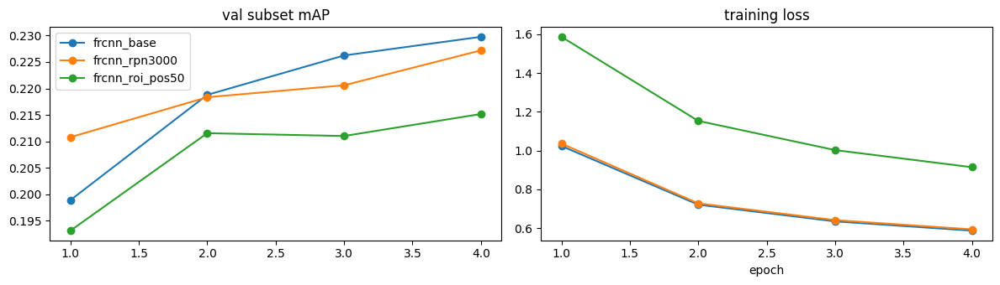

| прогін | mAP | AP50 | AP75 | AP_S | AP_M | AP_L | GPU мс | LB |
|---|---|---|---|---|---|---|---|---|
| base (1000 proposals, 512 RoI, 25 % поз.) | 0.2245 | 0.458 | 0.194 | 0.105 | 0.206 | 0.417 | 66 | 0.2172 |
| rpn3000 | 0.2237 | 0.457 | 0.192 | 0.113 | 0.212 | 0.412 | 111 | - |
| roi_pos50 (256 RoI, 50 % поз.) | 0.2171 | 0.443 | 0.189 | 0.103 | 0.207 | 0.389 | 66 | - |

- 3000 пропозицій піднімають AP_S (+0.008) і AP bus (0.041 -> 0.072), але mAP не змінюється, а модель у 1.7 раза повільніша. Тому лишив base
- З 50 % позитивів друга стадія бачить менше фонових RoI і гірше вчиться відкидати складний фон: більше впевнених FP, AP_L -0.028

**Що дає кожна стадія** (recall при IoU >= 0.5, score >= 0.3)

|  | large | medium | small | усі |
|---|---|---|---|---|
| стадія 1 (proposals) | 0.991 | 0.802 | 0.641 | 0.792 |
| стадія 2 (детекції) | 0.928 | 0.697 | 0.525 | 0.690 |

RPN зводить близько 10^5 якорів до 1000 пропозицій без класу, але 36 % малих об'єктів не отримують жодної (найменший якір 32 px, поріг позитиву 0.7, вхід 720). Тобто вони втрачені ще до другої стадії. Друга стадія класифікує (softmax з фоном) і ще раз уточнює рамку, і тут губиться ще близько 10 пунктів recall. RoI 7x7 для малого об'єкта збирається приблизно з 2x2 клітинок feature map, тому більше пропозицій мало що дає - у малих об'єктів просто замало пікселів

**Помилки (03_fig2, score >= 0.3, IoU >= 0.5).** На всьому val (114 132 об'єкти) 43 459 пропусків, 41 577 FP і 12 379 неправильних класів

1. Пропуски малих об'єктів у щільних сценах. Лівий кадр (найбільше пропусків): нічна вулиця, пропущено 56 з 93 об'єктів. Більшість зелених рамок без червоної пари - крихітні пішоходи на тротуарах і машини в далекому кінці дороги, часто поруч із засвіткою від фар. Ймовірні причини: немає пропозиції, крихітний RoI, і NMS (0.5) прибирає близьких сусідів
2. Плутанина класів. Правий кадр (найбільше неправильних класів): жваве денне перехрестя згори, 24 з 66 об'єктів знайдено, але з неправильним класом. Рамки на місці, але маленькі car, van, tricycle і motor з цього ракурсу дуже схожі. Типові пари - car і van, bicycle, motor і tricycle, а найбільше страждають рідкісні класи (AP bus 0.041)
3. Хибні спрацювання. Середній кадр (найбільше FP): вулиця в сутінках, 56 FP лише на 46 об'єктів. Багато червоних рамок на нерозміченому натовпі біля магазинів, одна - на банері з текстом посеред дороги, ще одна велика накриває темну ділянку зліва. Схоже, модель реагує на фон, схожий на об'єкти, і погане освітлення. Обмеження: ignored regions тут я не виключав, тож частина цих FP може бути всередині ignored regions, які офіційний mAP не рахує

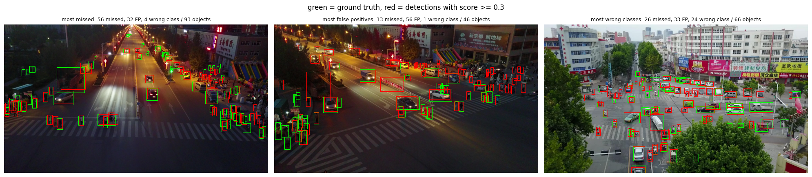

## 5. Одностадійний з якорями: RetinaNet (04_one_stage_retinanet)

retinanet_resnet50_fpn_v2, COCO-ваги, нова голова класів (GroupNorm, бо батч 4), протокол той самий, що у FRCNN. Якорі підбирав за даними. Покриття (частка GT, для яких є якір з IoU >= 0.5): стандартні 32-512 дають small 0.48 і всі 0.72, зсунуті 16-256 дають small 0.96 і всі 0.98

| прогін | mAP | AP50 | AP75 | AP_S | AP_L | LB |
|---|---|---|---|---|---|---|
| base (32-512, IoU 0.5/0.4, γ 2) | 0.178 | 0.341 | 0.163 | 0.067 | 0.352 | 0.172 |
| a16 (якорі 16-256) | 0.171 | 0.367 | 0.137 | 0.065 | 0.314 | - |
| a16_iou (+ IoU 0.4/0.3) | 0.165 | 0.350 | 0.134 | 0.066 | 0.306 | - |
| a16_g15 (+ focal γ 1.5) | 0.170 | 0.366 | 0.134 | 0.071 | 0.307 | - |

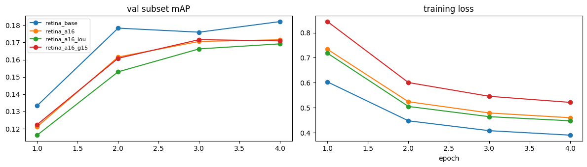

- Менші anchors знаходять більше об'єктів (AP50 росте, bicycle 0.14 -> 0.18), але гірше обводять (AP75 падає) і втрачають великі, бо найбільший якір тепер близько 406 px
- Покриття подвоїлось, а AP_S ні. Скоріше за все регресійна голова з COCO калібрована під старі розміри якорів, а найдрібніша сітка так і лишилась P3 (stride 8)
- Нижчі IoU-пороги додають неточні позитиви, тому стало гірше
- Focal γ 1.5 (зміна loss) дає найкращий AP_S

**Що змінюється без стадії пропозицій.** На кадр припадає близько 173 тис. якорів на 46 об'єктів у середньому, і цей дисбаланс тримає тільки focal loss. Рамка уточнюється один раз - тут допомогли б IoU-лоси або каскад. А покриття розмірів повністю залежить від дизайну якорів, тому варіанти - якорі з даних, ATSS або взагалі anchor-free

Проти налаштованого FRCNN: mAP нижчий на 0.05, AP75 0.163 проти 0.194 (немає другого уточнення), AP_S 0.067 проти 0.105, зате швидше (50 проти 66 мс)

## 6. Без якорів: YOLO11 (02_yolo_baseline, 05_anchor_free_yolo11)

**Як призначаються локації (TAL)**

- Кандидати - точки сітки всередині GT. Їх оцінка t = s^0.5 * IoU^6 рахується за поточними передбаченнями, топ-10 стають позитивами, при конфлікті точка дістається GT з більшим IoU
- Ціль класифікації - t замість 1, тому високий score також означає, що сама рамка добре розташована. Регресія - відстані до 4 країв (DFL + CIoU)
- 10-px об'єкт покриває 1-2 точки зі stride 8, великий - сотні. Сусіди в натовпі ділять точки і можуть зникнути після NMS (0.6). Голова P2 або більший вхід дають малим об'єктам більше точок

Пошук: епохи (12, 6) -> 6, бо 12-епоховий прогін мав найкращу епоху 2. Голова (P3-P5, P2-P5) -> P3-P5. Вхід (1280, 1536) -> 1536

| прогін | mAP | AP50 | AP75 | AP_S | AP_M | AP_L | навчання | LB |
|---|---|---|---|---|---|---|---|---|
| s 1280, 12 еп (02) | 0.198 | 0.395 | 0.174 | 0.108 | 0.184 | 0.362 | 107 хв | 0.2385 |
| s 1280, 6 еп | 0.203 | 0.397 | 0.181 | 0.120 | 0.203 | 0.316 | 47 хв | - |
| s-P2 1280 | 0.204 | 0.418 | 0.176 | 0.122 | 0.192 | 0.343 | 68 хв | - |
| s 1536 | 0.217 | 0.423 | 0.197 | 0.114 | 0.207 | 0.344 | 59 хв | 0.2312 |

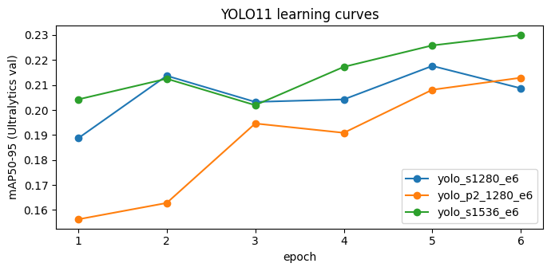

P2 допомагає bicycle і bus, але truck падає 0.28 -> 0.14. Думаю, причина в тому, що нові шари не мають pretrained weights, а 6 епох для них замало

**Порівняння за розміром (налаштовані моделі)**

| модель | mAP | small | medium | large |
|---|---|---|---|---|
| Faster R-CNN | 0.2245 | 0.105 | 0.206 | 0.417 |
| RetinaNet | 0.178 | 0.067 | 0.152 | 0.352 |
| YOLO11s 1536 | 0.217 | 0.114 | 0.207 | 0.344 |

Моє пояснення: YOLO обирає позитиви за своїми поточними передбаченнями, і її score також враховує якість рамки, що окупається на малих і середніх об'єктах. FRCNN виграє на великих, бо RoI Align бере ознаки саме з області рамки, а рамка уточнюється двічі

## 7. Запитовий: RT-DETR (06_query_based_rtdetr, 08_pipeline_model_rtdetr_5h)

- RT-DETR-L (COCO), ті самі 6 072 кадри, вхід 1280, бюджет 1 год (YOLO11s на 6 епох вистачило близько 45 хв)
- Угорський matching (вартість: клас + L1 + GIoU) дає кожному GT рівно один query, решта - "немає об'єкта". Дублікати штрафуються, тому NMS не потрібен і сусід у натовпі не видаляється
- Один позитив на об'єкт і нестабільне призначення на старті сповільнюють збіжність. RT-DETR це компенсує через query selection, denoising і auxiliary losses

| запити | mAP | AP50 | AP75 | AP_S | AP_M | AP_L | мс (+диск) | LB |
|---|---|---|---|---|---|---|---|---|
| 300 | 0.290 | 0.554 | 0.265 | 0.158 | 0.252 | 0.458 | 264 | 0.3389 |
| 500 | 0.275 | 0.527 | 0.249 | 0.136 | 0.245 | 0.457 | 249 | - |

Навіть у найзавантаженішому кадрі 180 об'єктів, тож 300 запитів уже достатньо. З 500 більшість запитів ніколи не зіставляється з жодним об'єктом, і за ту саму годину модель вийшла на нижчий mAP

RT-DETR вищий за YOLO11s з першої епохи (06_fig1): вже приблизно через 25 хв він перевершує найкращу точку YOLO11s, тож справа не в довшому бюджеті

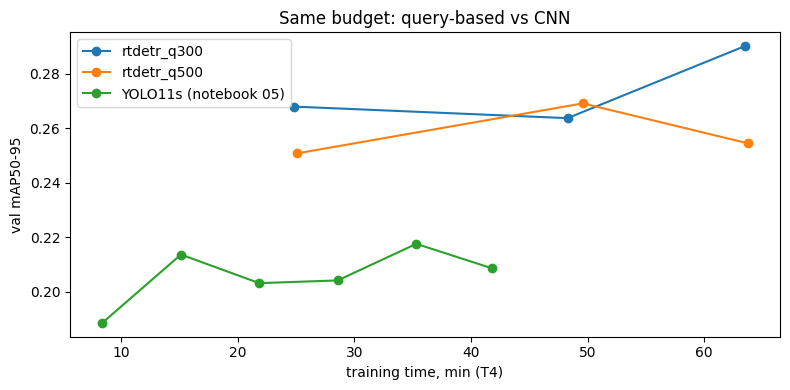

- За 1 год (3 епохи) модель не зійшлась: mAP ще ріс, а стрибок на 3-й епосі збігся із загасанням lr (cosine)
- Щоб перевірити, чи допоможе довше навчання, запустив 5 годин (08_pipeline_model_rtdetr_5h, 08_fig1). Найкраща епоха 4, а train-loss далі падає (GIoU 1.04 -> 0.45), тобто перенавчання. Val 0.273, LB 0.289
- Найкращий AP_S і AP bus (немає NMS, глобальний контекст, 6 уточнень рамки), але модель найповільніша, швидко перенавчається і видає максимум 300 детекцій

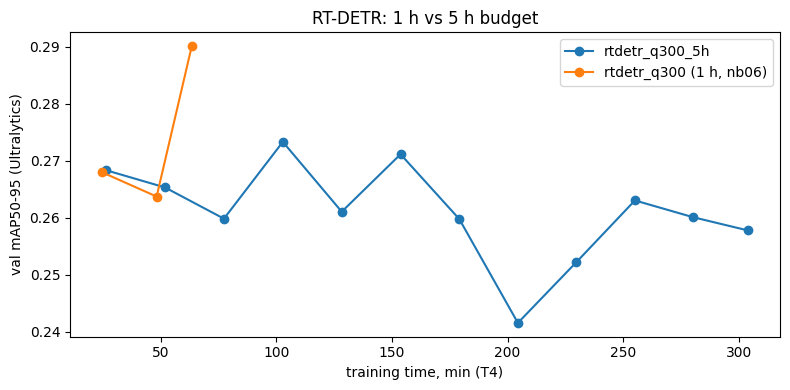

## 8. Пайплайн (07_pipeline_model_yolo11m, 09_final_pipeline)

**А. Стратегія інференсу** (ті самі ваги): flip-TTA з об'єднанням через WBF, тайли SAHI 2x2 (overlap 20 %) плюс прохід по всьому кадру

| модель | звичайний | вхід більший | + flip | + тайли | усе |
|---|---|---|---|---|---|
| RT-DETR q300 | 0.2904 | 0.2940 (1536) | 0.2980 | 0.3081 | 0.3095 |
| YOLO11m | 0.2254 | 0.2258 (1920) | 0.2402 | 0.2416 | 0.2457 |
| Faster R-CNN | 0.2245 | 0.2290 (900) | 0.2365 | - | 0.2400 |

Тайли піднімають AP_S у RT-DETR 0.158 -> 0.198, але інференс стає в 3.7 раза повільнішим (236 -> 877 мс/кадр, заміряно в 09)

**Б. Зміна моделі.** YOLO11s -> YOLO11m (07_pipeline_model_yolo11m, той самий протокол, 1536, 6 епох): val +0.008, LB 0.2312 -> 0.2978

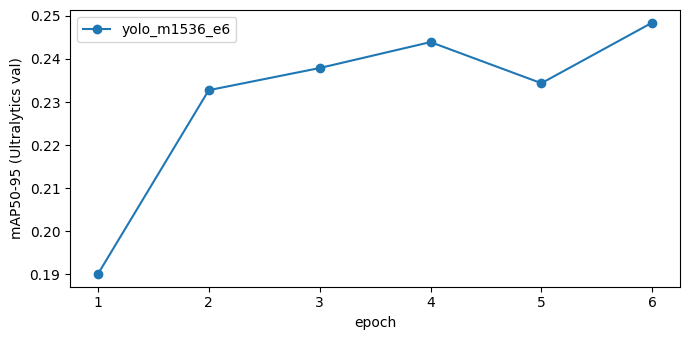

**В. Ансамблі (WBF)**

- A: жадібний відбір на val, стартуючи з RT-DETR з усіма трюками. Жодна модель не дала хоча б +0.002, тож лишилась одна модель (це і є C)
- B: WBF 5 моделей зі звичайним інференсом (YOLO11s, YOLO11m, FRCNN, RT-DETR q300 і q500), навмисно без відбору на val

| крок | val | Δ | LB | Δ |
|---|---|---|---|---|
| базова YOLO11s 1280 | 0.198 | - | 0.2385 | - |
| модель -> RT-DETR q300 | 0.290 | +0.092 | 0.3389 | +0.100 |
| інференс -> C | 0.3095 | +0.019 | 0.3390 | 0 |
| ансамбль B | 0.3028 | -0.007 | 0.3587 | +0.020 |

**Val і LB розходяться.** Ранги моделей різні: на LB YOLO сильніший, ніж на val

Гіпотези (розмітки тесту немає, тому перевірити не можу):

- 7 сцен val шумні й інші за складом
- best.pt, інференс і відбір я підганяв під цей самий val, а B - ні
- Публічний LB - лише частина тесту
- Тестові сцени іншої роздільності, тому тайли там можуть поводитись інакше

Висновок: основний приріст дала зміна моделі, а стратегії інференсу дали приріст лише на val. Правильніше було б робити крос-валідацію по кліпах, але на неї мені не вистачило GPU. Зведення всіх моделей - 09_fig1 і Додаток A

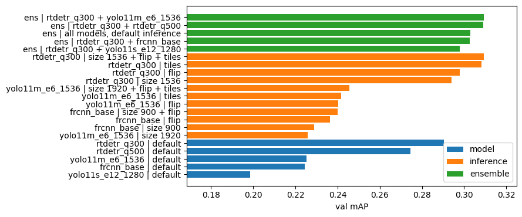

## 9. Невдалі спроби

Причини розібрано в розділах 4-8, це гіпотези без додаткових абляцій

| спроба | результат |
|---|---|
| FRCNN 3000 пропозицій / 50 % позитивів | mAP той самий / -0.007 |
| RetinaNet якорі 16-256, IoU 0.4/0.3 | -0.007 / -0.013 |
| YOLO 12 епох, голова P2 | як 6 епох, truck падає |
| RT-DETR 500 запитів, 5 год | -0.016, LB -0.050 |
| TTA і тайли на LB, ансамбль з відбором на val | 0 на LB, = одна модель |

## 10. Фінальна модель і запуск

**Фінальні сабміти:**

- B - WBF 5 моделей (LB 0.3587, без підгонки під val)
- C - RT-DETR q300 + 1536 + flip + тайли (найкращий val 0.3095)

Середовище: Kaggle, GPU T4, Internet on. torch 2.11, torchvision, ultralytics 8.4.202, pycocotools, seed 42. Спільні функції - src/vd_utils.py, кожен ноутбук записує його через %%writefile

1. 01_eda_split (CPU, 10 хв) -> vd_yolo/, vd_utils.py
2. Навчання (входи: дані змагання + output 01): 02_yolo_baseline (2 год), 03_two_stage_faster_rcnn (2 год), 05_anchor_free_yolo11 (3 год), 06_query_based_rtdetr (2.5 год), 07_pipeline_model_yolo11m (2.5 год)
3. 09_final_pipeline (входи: output 02, 03, 05, 06, 07, 6-7 год на T4, VAL_STEP=2 для швидкості) -> submission_B_all_default.csv, submission_C_single.csv. Передбачення кешуються в preds07/

Тільки для звіту: 04_one_stage_retinanet, 08_pipeline_model_rtdetr_5h (6 год)

W&B: https://wandb.ai/tebenko-pn-ucu/visdrone-hw2 - там лише 3 прогони Faster R-CNN. Проєкт може бути закритим через налаштування команди, тому скріншоти прогонів нижче

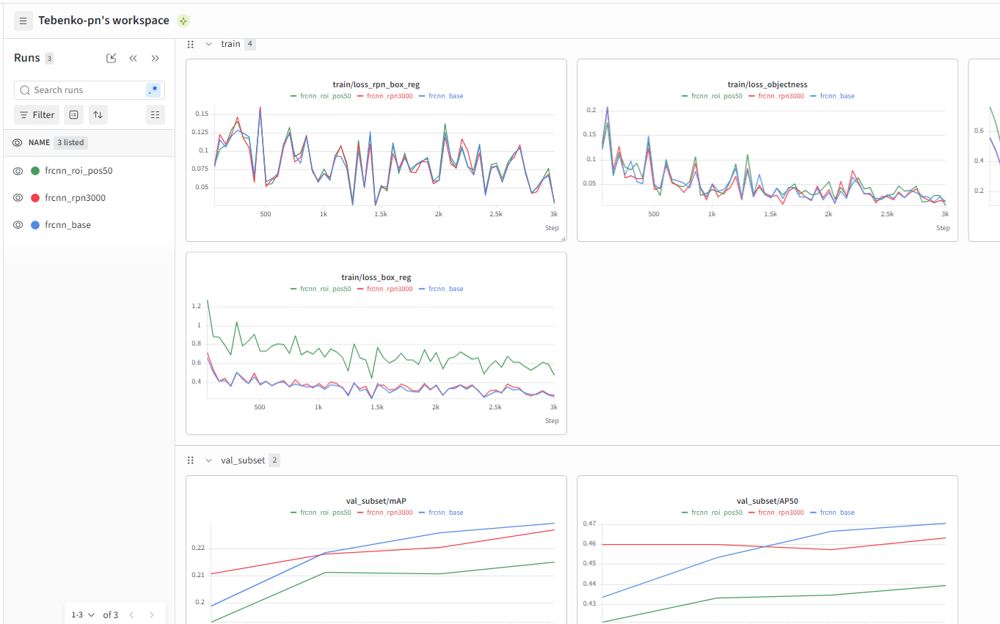

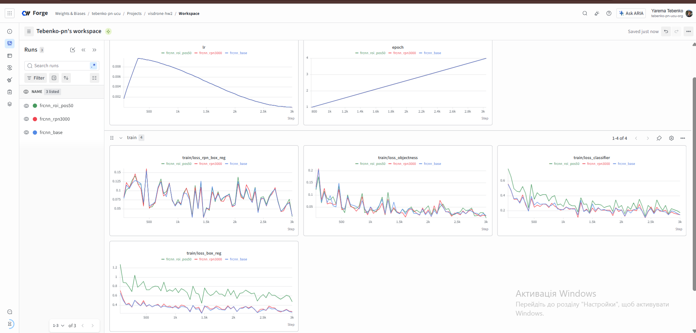

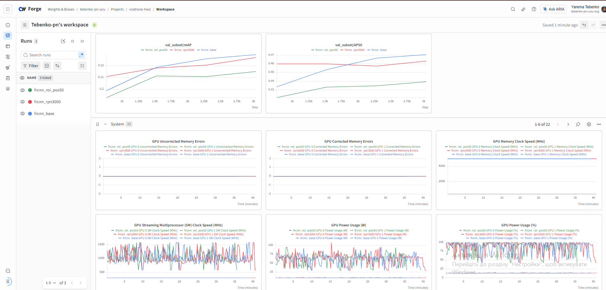

## Додаток A. Усі моделі (val і LB)

| ноутбук | модель | mAP | AP50 | AP_S | LB |
|---|---|---|---|---|---|
| 09 | B: WBF 5 моделей | 0.3028 | 0.574 | 0.166 | 0.3587 |
| 09 | C: RT-DETR + інференс | 0.3095 | 0.583 | 0.195 | 0.3390 |
| 06 | RT-DETR q300 | 0.290 | 0.554 | 0.158 | 0.3389 |
| 07 | YOLO11m 1536 | 0.225 | 0.448 | 0.124 | 0.2978 |
| 08 | RT-DETR q300, 5 год | 0.273 | 0.515 | 0.150 | 0.2891 |
| 02 | YOLO11s 1280, 12 еп | 0.198 | 0.395 | 0.108 | 0.2385 |
| 05 | YOLO11s 1536 | 0.217 | 0.423 | 0.114 | 0.2312 |
| 03 | Faster R-CNN base | 0.2245 | 0.458 | 0.105 | 0.2172 |
| 04 | RetinaNet base | 0.178 | 0.341 | 0.067 | 0.172 |

## Джерела

- VisDrone: https://arxiv.org/abs/2001.06303
- COCO (метрика mAP): https://arxiv.org/abs/1405.0312
- pycocotools: https://github.com/cocodataset/cocoapi
- Faster R-CNN: https://arxiv.org/abs/1506.01497
- FPN: https://arxiv.org/abs/1612.03144
- RetinaNet / focal loss: https://arxiv.org/abs/1708.02002
- TOOD (TAL у YOLO11): https://arxiv.org/abs/2108.07755
- Generalized Focal Loss (DFL): https://arxiv.org/abs/2006.04388
- DETR: https://arxiv.org/abs/2005.12872
- RT-DETR: https://arxiv.org/abs/2304.08069
- SAHI: https://arxiv.org/abs/2202.06934
- WBF (реалізовано за статтею): https://arxiv.org/abs/1910.13302
- TorchVision: https://docs.pytorch.org/vision/main/models.html
- Ultralytics: https://docs.ultralytics.com/
